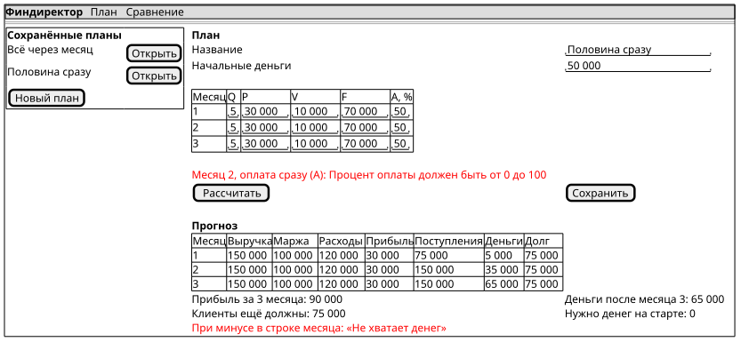
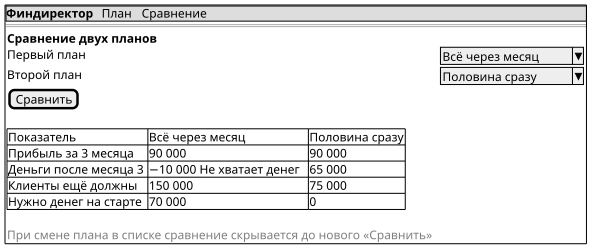

# ЛР5 — Интерфейс финансового директора

Документ описывает экраны Blazor-приложения до их реализации (ЛР5-Д1): что вводит пользователь,
какие действия ему доступны, что он видит в результате и как показываются ошибки.
Требования и примеры — в [requirements.md](requirements.md), операции — в [design.md](design.md).

## 1. Экраны

Регистрации нет, экранов два. Переход между ними — через меню слева.

| Экран | Адрес | Сценарий | Требования |
| --- | --- | --- | --- |
| «План» | `/` | С1 — создание, изменение и расчёт плана; С3 — сохранение и открытие | П-Ф1, П-Ф2, П-Ф4, П-Ф5, П-Ф6 |
| «Сравнение» | `/compare` | С2 — сравнение двух сохранённых планов | П-Ф3, П-Ф5, П-Ф6 |

## 2. Экран «План»

Макет: [ui-plan.puml](diagrams/ui-plan.puml), [ui-plan.svg](diagrams/ui-plan.svg).

### 2.1. Ввод

| Поле | Где | Ограничение (из Domain) |
| --- | --- | --- |
| Название | Над таблицей | Не пустое (П-Б10) |
| Начальные деньги | Над таблицей | ≥ 0, до копейки (П-Б8) |
| Q — количество услуг | Таблица, строка «Месяц 1/2/3» | Целое ≥ 0 |
| P — цена | Таблица | ≥ 0, до копейки |
| V — переменные затраты на услугу | Таблица | ≥ 0, до копейки |
| F — постоянные расходы | Таблица | ≥ 0, до копейки |
| A — оплата сразу, % | Таблица | Целое от 0 до 100 |

Новый план открывается с контрольными значениями из постановки (50 000; Q = 5, P = 30 000,
V = 10 000, F = 70 000, A = 50), чтобы их было удобно менять.

### 2.2. Действия

| Кнопка | Что делает | Операция Application |
| --- | --- | --- |
| «Новый план» | Очищает форму, создаёт новый идентификатор | `PlanDraft.CreateNew()` |
| «Рассчитать» | Проверяет ввод и строит прогноз трёх месяцев | `PlanService.Build`, `PlanService.Forecast` |
| «Сохранить» | Проверяет ввод и сохраняет план; тот же Id — обновление | `PlanService.Build`, `PlanService.Save` |
| «Открыть» (в списке) | Загружает сохранённый план в форму | `PlanService.List`, `PlanService.Open`, `PlanDraft.From` |

### 2.3. Результат (П-Ф2, П-Б7)

Таблица трёх месяцев: выручка, маржинальный доход, расходы, прибыль, поступления,
деньги на конец месяца, задолженность клиентов. Если деньги на конец месяца отрицательные,
в строке месяца стоит подпись **«Не хватает денег»** (ЛР5-Ф2).

Под таблицей итоги: прибыль за 3 месяца, деньги после месяца 3, клиенты ещё должны (D3, отдельно
от денег), сколько денег нужно добавить на старте (потребность в финансировании).

Все числа берутся из `PlanForecast` и `MonthReport`; в Razor-компонентах формул нет (ЛР5-А1).

### 2.4. Ошибки (П-Ф5)

`PlanService.Build` переводит ошибку конструктора Domain в `PlanInputException` с полем и причиной.
Экран показывает сообщение красным над кнопками, например:
«Месяц 2, оплата сразу (A): Процент оплаты должен быть от 0 до 100.».
Прогноз при ошибке не строится, план не сохраняется. Если в поле ввели не число, Blazor не примет
значение и подсветит поле.

### 2.5. Изменение данных (П-Ф6)

Любое изменение поля скрывает прежний прогноз и сообщение «Сохранено».
Новый прогноз появляется только после «Рассчитать» и считается заново с исходных данных.

## 3. Экран «Сравнение»

Макет: [ui-compare.puml](diagrams/ui-compare.puml), [ui-compare.svg](diagrams/ui-compare.svg).

- **Ввод:** два плана из выпадающих списков сохранённых планов (`PlanService.List`).
- **Действие:** «Сравнить» — оба плана открываются из хранилища и считаются отдельно (`PlanService.Compare`).
- **Результат (П-Ф3):** таблица из двух столбцов: прибыль за 3 месяца, деньги после месяца 3,
  клиенты ещё должны, нужно денег на старте. Отрицательные деньги подписаны «Не хватает денег».
- **Ошибки:** не выбраны два плана или выбран один и тот же — «Выберите два разных плана»;
  плана нет в хранилище — «План не найден».
- **П-Ф6:** при смене любого из выбранных планов прежнее сравнение скрывается до нового нажатия «Сравнить».
  Сравнение всегда берёт последние сохранённые данные, поэтому изменённый и пересохранённый план
  сравнивается уже с новыми числами.

## 4. Связь с Application (ЛР5-А1)

Чтобы в Razor не было ни формул, ни проверок, в Application добавлено:

- `PlanDraft` и `MonthDraft` — изменяемые поля формы (то, что пользователь сейчас ввёл);
- `PlanService.Build(PlanDraft)` — создаёт `FinancialPlan` и при ошибке бросает `PlanInputException`
  с понятным названием поля и месяца;
- `PlanDraft.From(FinancialPlan)` — заполняет форму из открытого плана.

Компоненты вызывают только эти операции и `PlanService.Forecast`, `Compare`, `Save`, `List`, `Open`,
а затем выводят готовые числа.

## 5. Проверка на числовом примере

Сценарий П2 из requirements.md: 50 000; Q = 5, P = 30 000, V = 10 000, F = 70 000, A = 50.
На экране «План» после «Рассчитать» ожидаются деньги 5 000 / 35 000 / 65 000, прибыль 90 000,
D3 = 75 000, потребность 0. При A = 0 (план П1) месяцы 1–3 имеют минус и подпись «Не хватает денег»,
потребность 70 000. Протокол сквозной проверки — в [e2e.md](e2e.md).
